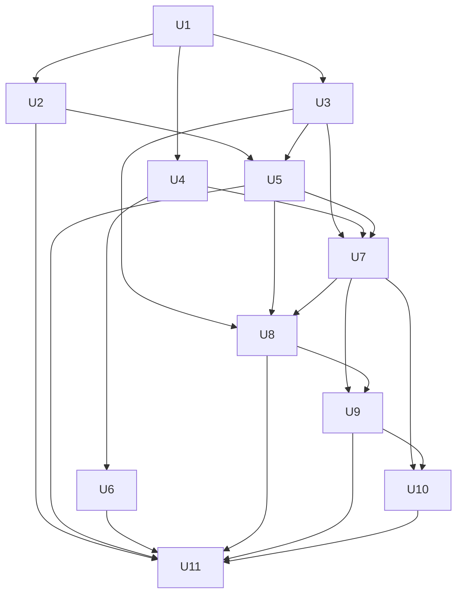

# Plan — production hardening

| Unit | Title | Depends on |
|------|-------|------------|
| U1 | Test harness, local Supabase seed, CI check job | — |
| U2 | Staff-only access: RLS + storage + audit/tally lock-down | U1 |
| U3 | Money views: no double count, exclude cancelled/draft | U1 |
| U4 | Integrity: amount edits, unique PO/PI numbers, PI status, FK indexes, search_path | U1 |
| U5 | Brought-forward / pre-cutoff matching (per D2) | U2, U3 |
| U6 | Upload flow safety: replace choice, lookup race, site/link resets, detector fixes | U4 |
| U7 | Forms & pages: stale filters, error handling, races, payments crash, GST, TDS date, validation | U3, U4, U5 |
| U8 | Pagination: remove 1000-row truncation | U3, U5, U7 |
| U9 | UX: not-found states, friendly errors, mobile tables, dates in IST | U7, U8 |
| U10 | Code health: lint to zero, deps cleanup + audit, archive old SQL, docs, session cookie | U7, U9 |
| U11 | Verify: full suite, browser re-test, security re-scan, audit statuses, ship | U2, U5, U6, U8, U9, U10 |

Units that touch the same files (`reports/page.tsx`, `period.ts`, `documents.ts`, `statement/page.tsx`) are chained so they run one at a time.
